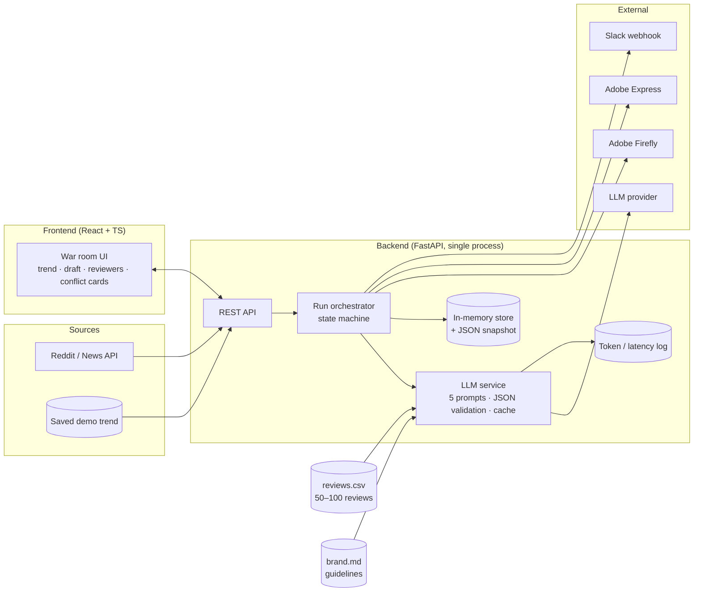
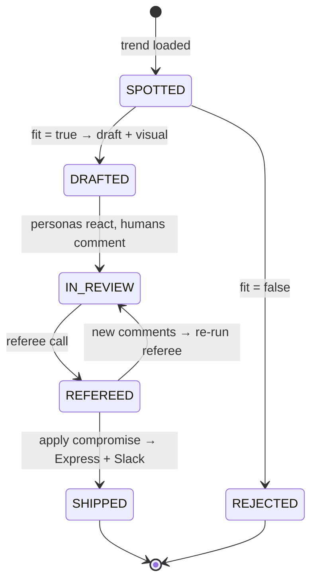

# Moment: Architecture

> **Brands miss trends because approval takes days. Moment gets a trend to an approved post in 2 hours.**

IT Fest Adobe Hackathon, "Marketing Reimagined". Team: Stefan, Andu, Militaru, Anda.
Status: **Proposed** (freeze in hour 1). Date: 2026-11-07.

---

## 1. Goals and constraints

| | |
|---|---|
| **Build time** | 12 hours, 4 people working in parallel |
| **Must show live** | trend → fit check → draft in Express → human + persona review → conflict card → apply → Slack |
| **Scale** | one demo brand, one user, one run at a time. No multi-tenancy, no auth |
| **Reliability** | the demo must work 3/3 times. Every external call needs a fallback |
| **Cost** | ~5 LLM calls per run, logged per call for the cost-vs-value slide |
| **Judging** | Problem 25 · AI 25 · Technical 25 · Integrations 15 · Demo 10 · Cost bonus +10 |

**Out of scope:** live multi-platform monitoring, scheduling, permissions, notifications, enforced timers, One Voice round-2 and pre-mortem, more than 3 personas.

---

## 2. System overview



One backend process, one frontend, flat files for data. It's deliberately a **modular monolith**: separate modules (`trends`, `llm`, `adobe`, `slack`, `runs`) inside one service, so each person owns a folder but there's only one thing to deploy and debug (see ADR-001).

---

## 3. The run lifecycle

A **Run** is one trend going through the pipeline. The orchestrator moves it through a simple state machine:



**`needs_human`.** When the Referee returns `status: "needs_human"` the run is still `REFEREED`; there is no extra state. The UI shows a warning banner, and `POST /runs/{id}/apply` is **allowed**: the click is the human decision. A blank `final_caption` never reaches Express; the current caption is kept.

### End-to-end sequence

```mermaid
sequenceDiagram
    autonumber
    participant UI
    participant API as Backend
    participant LLM as LLM provider
    participant AD as Firefly / Express
    participant SL as Slack

    UI->>API: GET /trend
    API-->>UI: trend (live or saved)
    UI->>API: POST /runs {trend_id}
    API-->>UI: Run (SPOTTED), returns immediately
    Note over API,AD: background task; UI polls GET /runs/{id}
    API->>LLM: #1 Fit check (trend + brand.md)
    LLM-->>API: {fits, score, reason}
    API->>LLM: #2 Draft (trend + brand.md)
    LLM-->>API: {brief, caption, visual_prompt}
    API->>AD: generate visual, create/update post
    API-->>UI: poll shows DRAFTED (caption, image, express link)

    par Synthetic audience
        API->>LLM: #4 Persona reactions (draft + 3 cached personas)
        LLM-->>API: reactions[]
    and Human reviewers
        UI->>API: POST comments (Brand, Legal, Product)
    end

    UI->>API: POST /runs/{id}/referee
    API->>LLM: #5 Referee (comments + reactions + canvas text)
    LLM-->>API: {conflicts, edits, tasks, comment_status, final_caption}
    API-->>UI: conflict cards + edits

    UI->>API: POST /runs/{id}/apply
    API->>AD: update caption / visual
    API->>SL: final post + task list
    API-->>UI: SHIPPED, elapsed time
```

Call **#3 (build personas)** runs once at startup from `reviews.csv` and is cached, so it isn't on the critical path of the demo.

---

## 4. Components

### 4.1 Frontend (owner: Andu)
- React + TypeScript (Vite). Adobe Spectrum components optional; a nice nod to the judges' stack.
- One page, three columns: **Trend** (card + fit reason) · **Canvas** (caption + visual, or Express embed) · **Review table** (3 human reviewer cards with a display-only timer, 3 persona cards in the same style, conflict cards underneath).
- Polls `GET /runs/{id}` every second (simpler than websockets; see ADR-004).
- Built against mock JSON from hour 1; switches to the real API at the hour-4 checkpoint.

### 4.2 Backend API + orchestrator (owner: Stefan)
- FastAPI, Pydantic models for every request/response, so the API contract and validation are the same code.
- The orchestrator owns state transitions; endpoints never call each other.
- **Demo mode** flag: every external call has a cached last-good response that's returned if the call fails or exceeds a timeout.

### 4.3 LLM service (owner: Stefan)
Five prompts, each with a Pydantic output schema. The model is asked for JSON; the response is validated, and retried once on a schema error, then falls back to cache.

| # | Call | Input | Output | When |
|---|---|---|---|---|
| 1 | Fit check | trend, brand.md | `FitResult` `{fits, score 0–100, reason}` | per run |
| 2 | Draft | trend, brand.md | `{brief, caption, visual_prompt, hashtags}` | per run |
| 3 | Build personas | reviews.csv | 3 × `{name, segment, cares_about, pet_peeves, sample_quotes}` | once, cached |
| 4 | Persona reactions | draft, 3 personas | 3 × `{persona, reaction, sentiment -1..1, would_engage}` | per draft (one call for all 3) |
| 5 | Referee | human comments, persona reactions, canvas text, brand.md | Referee JSON (§6) | per review round |

Every call writes `{run_id, call, model, input_tokens, output_tokens, latency_ms}` to `logs/usage.jsonl` (`run_id` is null for call #3). `GET /usage` aggregates it and adds `cost_usd`, computed from a per-model price table. That file is the input for the cost slide.

### 4.4 Trend source (owner: Militaru)
- One source: Reddit (subreddit `top`/`hot` JSON) or a news API. It's normalised to the `Trend` model.
- `data/demo_trend.json` is always available; the demo uses it by default and live fetch is a nice-to-have.

### 4.5 Adobe integration (owner: Militaru)
- **Visual:** Firefly image generation from `visual_prompt`.
- **Post:** the draft placed in Adobe Express (Embed SDK or add-on, depending on what access works by hour 2); "apply" updates the caption/visual there.
- **Fallback:** pre-generated image + our own canvas preview + "Open in Express" link. Decision point: **hour 2** (see ADR-003).

### 4.6 Slack (owner: Militaru)
- Incoming webhook to a demo channel. A Block Kit message with the final caption, the image, the task list and "Trend → approved: 1h 50m".

### 4.7 Data (owner: Anda)
- `data/brand.md`: voice, do/don't, legal no-gos (competitor names, claims, etc.).
- `data/reviews.csv`: `text, rating, source`, 50–100 real reviews.
- `data/demo_trend.json`, `data/demo_comments.json`: the scripted judge comments, used for testing and as a fallback.

---

## 5. API contract

| Method | Path | Body | Returns |
|---|---|---|---|
| GET | `/trend` | | `Trend` |
| GET | `/personas` | | `Persona[]` (cached at startup) |
| POST | `/runs` | `CreateRunRequest` `{trend_id}` | `Run` **immediately**, status `SPOTTED`. Fit + draft run in a background task |
| GET | `/runs/{id}` | | `Run` (UI polls every 1s until `DRAFTED` or `REJECTED`; `step` shows progress) |
| POST | `/runs/{id}/reactions` | | `PersonaReaction[]` (synchronous, must stay < ~10s) |
| POST | `/runs/{id}/comments` | `CommentCreate` `{role, text, author?}` | `Comment` (with `weight`, see `docs/comment-weighting.md`) |
| POST | `/runs/{id}/referee` | | `RefereeResult` (synchronous, must stay < ~10s) |
| POST | `/runs/{id}/apply` | `ApplyRequest` `{conflict_ids?, accept_all_edits}` | `Run` (status `SHIPPED`) |
| GET | `/usage?run_id=` | | `UsageSummary` (no `run_id` = totals across all runs) |
| POST | `/admin/demo-mode` | `DemoModeRequest` `{on}` | `DemoModeResponse` `{on}` |

### Conventions

- JSON uses the same **snake_case** names as Python, no aliases. Datetimes are **ISO 8601 UTC** strings.
- Every route declares `response_model=...`, so `/openapi.json` is complete. The frontend generates its TS types from it with `openapi-typescript`.
- Routes have **no `/api` prefix**. The Vite proxy rewrites `/api/*` → `:8000/*`.
- Errors are `HTTPException` with `{"detail": str}`: **404** unknown run, **409** invalid state transition (e.g. `apply` before `referee`, `reactions` on a `REJECTED` run).
- `POST /runs` is non-blocking: if fit says `fits=false` the run ends `REJECTED` (with `fit.reason`); a failure in draft falls back to the cached draft (demo mode) and never leaves the run stuck in `SPOTTED`.
- `Run.step` is a human-readable string ("Checking brand fit…", "Generating visual…") while a background job runs, otherwise `null`.
- `Conflict.positions` is keyed by `ConflictParty.id`. Persona ids never equal a comment role (`brand`, `legal`, `product`), so ids are unambiguous across both kinds.
- Mock for the frontend: `backend/tests/fixtures/run_refereed.json` (a `Run` in status `REFEREED` with two conflicts).

---

## 6. Data model

```python
class Trend(BaseModel):
    id: str
    title: str
    source: Literal["reddit", "news", "saved"]
    url: str | None = None
    summary: str
    detected_at: datetime

class FitResult(BaseModel):
    fits: bool
    score: int           # 0–100
    reason: str

class Draft(BaseModel):
    brief: str
    caption: str
    visual_prompt: str
    hashtags: list[str] = []
    image_url: str | None = None
    express_doc_id: str | None = None
    version: int = 1  # bumps on every apply

class Persona(BaseModel):
    id: str              # never equal to a Comment role
    name: str            # e.g. "Student night owl"
    segment: str
    cares_about: list[str]
    pet_peeves: list[str]
    sample_quotes: list[str]  # pulled from reviews.csv

class PersonaReaction(BaseModel):
    persona_id: str
    reaction: str
    sentiment: float  # -1..1
    would_engage: bool

class Comment(BaseModel):
    id: str
    role: Literal["brand", "legal", "product"]
    text: str
    created_at: datetime
    # weighting, set by the backend only (docs/comment-weighting.md)
    author: str | None = None
    author_title: str | None = None
    industry_verified: bool = False
    weight: float = 1.0   # expertise x recency, refreshed on every GET /runs/{id}

class ConflictParty(BaseModel):
    kind: Literal["human", "persona"]
    id: str              # comment role ("legal") or persona_id
    label: str           # display text, e.g. "Legal", "Student night owl"

class Conflict(BaseModel):
    id: str
    between: list[ConflictParty]
    summary: str
    positions: dict[str, str]   # keyed by ConflictParty.id
    compromise: str

class Edit(BaseModel):
    target: Literal["caption", "visual_prompt", "hashtags"]
    before: str          # for "hashtags": space-joined, e.g. "#a #b"
    after: str
    source_comment_id: str

class Task(BaseModel):
    owner: str
    task: str
    due: str

class CommentStatus(BaseModel):
    comment_id: str
    status: Literal["applied", "in_conflict", "rejected"]
    why: str

class RefereeResult(BaseModel):
    conflicts: list[Conflict]
    edits: list[Edit]
    tasks: list[Task]
    comment_status: list[CommentStatus]
    final_caption: str
    status: Literal["ready_to_ship", "needs_human"]

class Run(BaseModel):
    id: str
    trend: Trend
    fit: FitResult | None = None
    draft: Draft | None = None
    reactions: list[PersonaReaction] = []
    comments: list[Comment] = []
    referee: RefereeResult | None = None
    status: Literal["SPOTTED", "REJECTED", "DRAFTED", "IN_REVIEW", "REFEREED", "SHIPPED"]
    step: str | None = None   # current background step, for loading states
    started_at: datetime
    shipped_at: datetime | None = None

# Request bodies: CreateRunRequest{trend_id}, CommentCreate{role, text, author?},
# ApplyRequest{conflict_ids?: list[str], accept_all_edits: bool},
# DemoModeRequest{on}, DemoModeResponse{on}

class CallUsage(BaseModel):
    call: str
    model: str
    input_tokens: int
    output_tokens: int
    latency_ms: int
    cost_usd: float

class UsageSummary(BaseModel):
    run_id: str | None = None   # None = totals across all runs
    calls: list[CallUsage]
    total_input_tokens: int
    total_output_tokens: int
    total_cost_usd: float
```

`backend/app/models.py` is the source of truth; this section mirrors it.

Storage: a Python dict keyed by run id, snapshotted to `data/runs.json` after each transition, so a backend restart mid-demo doesn't lose the run.

---

## 7. Security and safety

Small, but worth a line on the architecture slide; it's part of "technical excellence".

- **Prompt injection from trends.** Reddit and news text is untrusted input. It is passed to the model inside clearly delimited `<trend>` tags with an instruction to treat it as data only, and the fit/draft outputs are schema-validated, so injected text can't change the output shape or trigger actions.
- **Reviewer comments are also untrusted.** Same delimiting in the Referee prompt; the Referee can only *propose* edits, and a human clicks "apply".
- **Human in the loop.** Nothing reaches Express or Slack without the "apply" click.
- **Secrets.** LLM, Adobe and Slack keys in `.env`, never committed (`.gitignore` from minute one); the frontend never sees a key.
- **Brand safety.** brand.md "legal no-gos" are part of every draft and referee prompt, so Legal-type conflicts are caught even without a human Legal comment.
- **Review data.** Only review text and rating are used; strip usernames before they go into the CSV.

---

## 8. Architecture decisions

### ADR-001: Modular monolith instead of microservices
**Status:** Accepted · **Deciders:** whole team

**Context:** 12 hours, 4 people, one demo. Judges reward "solid architecture and reliability", not service count.

| Option | Complexity | Reliability on stage | Parallel work |
|---|---|---|---|
| **A. Modular monolith (one FastAPI app, folder per owner)** | Low | High: one process to keep alive | Good with frozen contracts |
| B. Separate services (trend, LLM, integrations) | High | Lower: more moving parts, networking | Good |
| C. Frontend-only, LLM calls from browser | Lowest | Medium | Poor; exposes API keys |

**Decision:** A. **Consequences:** easy to run and debug; we explain the module boundaries on the architecture slide as "ready to split into services". Revisit only if this goes past the hackathon.

### ADR-002: Referee as one structured LLM call
**Status:** Accepted · **Deciders:** Stefan

**Context:** The Referee must find conflicts across humans *and* personas, turn vague comments into edits, propose a compromise and set per-comment status.

| Option | Complexity | Latency | Consistency |
|---|---|---|---|
| **A. One call, one JSON schema** | Low | 1 round trip | High: sees all feedback at once |
| B. Agent chain (classify → detect conflicts → rewrite → merge) | High | 3–4 round trips | Medium: steps can disagree |
| C. Rule-based conflict detection + LLM rewrite | Medium | 1–2 | Low recall on subtle conflicts |

**Decision:** A. A single call that sees everything is what makes the "humans and personas at the same table" idea real, and it's 1 of ~5 calls per run, which helps the cost slide. **Risk:** the conflict might not appear with the demo inputs → tune the prompt against `demo_comments.json` until it appears 3/3 times.

### ADR-003: Adobe Express live update vs fallback preview
**Status:** Proposed; decide at hour 2 · **Deciders:** Militaru, Stefan

| Option | Integrations score | Risk |
|---|---|---|
| **A. Firefly image + live Express update on apply** | Highest | Access/credentials or SDK friction |
| B. Firefly image + own preview + "Open in Express" | Medium | Low |
| C. Pre-made image, own preview | Low | None |

**Decision:** aim for A; if Express access isn't working by hour 2, ship B and keep A as a stretch goal. C is the demo-mode fallback only.

### ADR-004: Polling instead of websockets
**Status:** Accepted

1-second polling of `GET /runs/{id}` is enough for one viewer and removes a whole class of connection bugs. Websockets add little visible value in a 3-minute demo.

### ADR-005: Personas built once from real reviews
**Status:** Accepted

Building personas from `reviews.csv` (call #3, cached) instead of hand-writing them makes the claim "the synthetic audience comes from real customers" true and showable (each persona card can show 1–2 source quotes). One call for all 3 reactions (#4) keeps the run at ~5 calls.

---

## 9. Repository layout

```
moment/
├── backend/
│   ├── app/
│   │   ├── main.py            # FastAPI app, routes          (Stefan)
│   │   ├── models.py          # Pydantic models (§6)          (Stefan, frozen hour 1)
│   │   ├── orchestrator.py    # run state machine             (Stefan)
│   │   ├── llm/
│   │   │   ├── client.py      # provider call, retry, logging (Stefan)
│   │   │   └── prompts/       # fit, draft, personas, reactions, referee
│   │   ├── trends.py          # Reddit/news + saved trend     (Militaru)
│   │   ├── adobe.py           # Firefly + Express             (Militaru)
│   │   ├── slack.py           # webhook + Block Kit           (Militaru)
│   │   └── demo_cache.py      # last-good responses
│   └── tests/test_flow.py     # end-to-end with demo data
├── frontend/                  # React + TS                    (Andu)
│   └── src/mocks/             # JSON mocks from §6, hour 1
├── data/                      # brand.md, reviews.csv, demo_*.json (Anda)
├── logs/usage.jsonl
├── .env.example
└── ARCHITECTURE.md
```

---

## 10. Cost model (for the bonus slide)

Per run: calls #1, #2, #4, #5 (+ #3 once). Fill in from `logs/usage.jsonl` after rehearsals:

```
cost_per_run = Σ (input_tokens × input_price + output_tokens × output_price)  + Firefly generation
value_per_run = reviewer hours saved × hourly rate  + value of hitting the trend window
```

Show it as one line: "≈ $X per post vs. Y hours of review time", with X measured, not estimated.

---

## 11. Risks and fallbacks

| Risk | Likelihood | Fallback |
|---|---|---|
| LLM returns invalid JSON | Medium | Schema retry once → cached response |
| LLM slow on venue Wi-Fi | Medium | Timeout 15s → cached response; phone hotspot |
| Conflict doesn't appear live | Medium | Prompt tuned on scripted comments; demo mode |
| Express access blocked | Medium | ADR-003 option B |
| Firefly quota/credentials | Low–Med | Pre-generated image |
| Reddit rate limit / nothing relevant trending | High | Saved demo trend (default) |
| Laptop / everything fails | Low | Recorded backup video |

## 12. Action items

1. [ ] Hour 1: commit `models.py` + frontend mocks (Stefan, Andu)
2. [ ] Hour 2: Adobe access decision, ADR-003 (Militaru)
3. [ ] Hour 2: `brand.md`, `reviews.csv`, `demo_trend.json` ready (Anda)
4. [ ] Hour 4: end-to-end run through the real backend (all)
5. [ ] Hour 6: conflict appears 3/3 with scripted comments (Stefan)
6. [ ] Hour 8: feature freeze; usage log → cost slide (Stefan → Anda)
